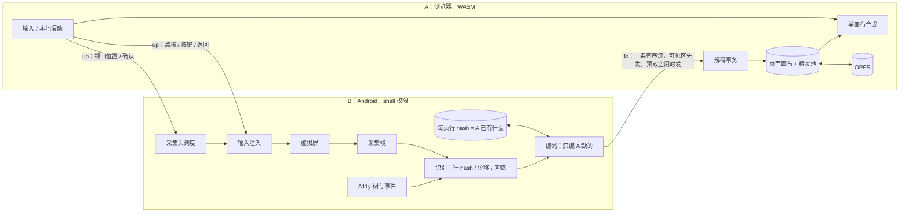

# 活镜投屏 · 开发计划

> IDEA.md 是金标准。本文是总览和入口，展开内容在 `doc/`；两者冲突以 IDEA 为准。
> 执行者从 [doc/90-tasks.md](doc/90-tasks.md) 开始，按顺序做。

A = 浏览器（或手机浏览器）里的查看端；B = 被控的 Android 设备。
A→B：白名单开 / 点 / 滑 / 返。B→A：单画布画面。

## 1. 用户能看到什么

| # | 需求 | 展开 |
|---|---|---|
| U1 | 浏览器打开查看页（HTTPS 托管的单页，任何设备可用；开发时可用 localhost），右上角选白名单 App，进入单应用会话；没有状态栏、通知、HOME | 60、70 |
| U2 | 文字和 symbolic 图标逐像素锐利；图片有损，质量可调 | 40 |
| U3 | 左键点按 / 长按 / 拖动，键盘按键，Ctrl+C / Ctrl+V | 70、60 |
| U4 | 滚轮、拖动、滚动条都在本地立即响应；见过的内容来回滚不产生下行流量；匀速滚动看不到空白 | 30 |
| U5 | 右键 / Esc / 浏览器后退 = 返回，上一页立即出现 | 20、70 |
| U6 | 刷新页面、断线重连、隔天再开，去过的页面不重新下载 | 20、50 |
| U7 | l 键：三层比重、可调项、省流百分比；r 键：最近刷新矩形 / 图文视三类区遮罩；可导出长截屏 | 70、40 |
| U8 | 退出或崩溃后，B 的动画和模糊设置被还原；B 可以熄屏 | 60 |
| U9 | 以上在 300–800 KB/s 的 Tailscale 链路上成立 | 50、80 |

## 2. 数据流

## 3. 六条规则

1. **像素为真，A11y 只提案。** A11y 给出的滚动区、图片框、页面身份，都要过一次像素检验才生效。A11y 晚到或出错，只损失省流，不出错图，也不挡出图。
2. **B 编码的是“最新一帧”对“A 已有的内容”，不是对上一帧。** 所以中间帧可以随便丢，A 的视口也不必等于 B 的屏幕。
3. **A 的视口和 B 的采集头是两回事。** 用户滚动只动视口；采集头由调度器决定，负责把画布填上。
4. **进画布的内容必须稳定。** 按下高亮、光标、转圈这类短暂变化走 Overlay，不改底图。
5. **B 对“A 有什么”的认识只有两个来源。** 同一连接内：发出去的就算（画面数据是一条有序流，A 按序应用）。跨连接：只认 A 报告的已落盘版本。
6. **先有录制和 bench，再调启发式。** 参数都进参数表，可按全局 / App / 页面覆盖，不写死。

## 4. 模块与目录

| 目录 | 语言 | 职责 |
|---|---|---|
| `host-adb/` | Kotlin（app_process） | 虚拟屏、采集、A11y、注入、全局设置开关与还原、白名单、剪贴板、录制 |
| `rd/` | Rust，一个 crate 编成 Android .so 和 WASM | wire 枚举、编解码、页面状态机；**区域/语义侦测**（`region.rs`）与**启发式/规则集合**（`heuristics.rs`，含精确滚轮公式、预测滚动、分类与自适应阈值）各自独立成单文件，不散落。两端和 bench 共用 |
| `host-net/` | Rust（和 rd 链进同一个 .so） | WebTransport 服务端 |
| `viewer/` | TS + rd.wasm | 合成、输入、OPFS、调试面板 |
| `bench/` | Rust（复用 rd） | 离线重放、报表、消融 |
| `e2e/` | JS | 场景脚本与 runner（`corpus/appi.js` 的精简重写） |
| `doc/` | — | 展开文档 |

## 5. 文档

| 文件 | 回答什么 |
|---|---|
| [10-dataflow](doc/10-dataflow.md) | 一帧、一次点击、一次滚动各走哪几步；状态归谁；断了怎么恢复 |
| [20-pages](doc/20-pages.md) | 页面 / 区域 / 画布 / 精灵 / Overlay；换页判定；返回栈；持久化与 `cache_rev` / `pg_rev` |
| [30-scroll](doc/30-scroll.md) | 本地滚动、采集头、超高虚拟屏、预取、点击换算、滚动条、横向 tab |
| [40-codec](doc/40-codec.md) | 行 hash、位移、缺什么发什么、Palette / 行引用（IBC）/ 精灵 / 有损图片、三层统计 |
| [50-protocol](doc/50-protocol.md) | 流、消息骨架、握手与缓存对齐、传输设置、参数表 |
| [60-host](doc/60-host.md) | B 端启动顺序、虚拟屏、A11y、注入、设置还原、白名单、平台探针 |
| [70-viewer](doc/70-viewer.md) | 输入映射、合成顺序、history、l / r 调试面、OPFS |
| [80-corpus-bench](doc/80-corpus-bench.md) | 现有语料的结构建议、录制格式、场景、bench、与 scrcpy 对比、消融 |
| [90-tasks](doc/90-tasks.md) | 给执行者的任务顺序，每项带“怎么确认” |

## 6. 里程碑

| 阶段 | 做什么 | 做完后能看到 |
|---|---|---|
| M0 工具链 | host 最小闭环、平台探针、录制器、场景脚本、bench 骨架、README oneliner | 一条命令录一段设置 App 的操作，一条命令出字节 / 耗时 / 峰值报表 |
| M1 能看能点 | WebTransport、基线编码（对 A 的状态求差 + 列掩码行 hash + Palette / zstd + 基础有损图片）、输入、选包、设置开关与还原、r 遮罩 | 浏览器里操作设置 App：能点、能打字、能返回；文字锐利、图片有损省流；画面静止时下行为零 |
| M2 本地滚动 | 页面与区域（`region.rs`）、`Overlay`（瞬态变化不脏画布）、画布与同页 `Copy`、位移、采集头与启发式（`heuristics.rs`）、右缘滚动条多帧一致性写入、点击换算与点前校验、长截屏导出 | 滚到底再滚回来，回程零像素流量；点按涟漪/光标不污染画布；导出的长截屏右缘无滚动条残影；远跳未对齐时落零散段（minimap 可看） |
| M3 页面缓存 | 返回栈、乐观返回、模态页、骨架分桶 + 稀疏行锚点认页、OPFS、版本对齐、断线重连 | 返回上一页立即出现；设置子页不串缓存；刷新浏览器后重进去过的页面不下载像素 |
| M4 图片精修与预取 | 图片圆角掩码与精灵去重、帧内拆小 `Tx`（文字先发、图片 8–16 KB 分片）、预取调度与发送纪律、提前量；超高虚拟屏只在 bench 证明 1× 不够时做 | 图片多的 App 首屏立即出字可点、圆角干净；匀速滚动长列表看不到占位块；预取不拖慢点击后的画面更新 |
| M5 压缩与消融 | 复核 `oracle dedupe` 上界（M2 起每份报表都带）；跨页/同 `Tx` 行引用、无损精灵池、消融报告、l 面板省流分项与自适应默认 | 重复控件与共用顶栏不重发；面板显示各项省了多少；无收益候选项凭消融数据砍掉 |
| M6 收尾 | 横向 tab / Drawer、fg 视频区、编辑器场景 | NewPipe 切 tab、qpython 编辑器可用 |

M2 之后每个阶段都要在 bench 上留一份报表，和上一阶段比。

## 7. 需要你拍板（已按默认写进文档）

| # | 问题 | 默认 |
|---|---|---|
| 1 | 三层怎么分 | bg = 无损布局（文字、symbolic 图标）；lit 精灵池 = 无损小图（返回键、开关）+ 有损图片；fg 只放视频区，最后做 |
| 2 | 录制怎么驱动 | `appi.js` 重写后不经过 Appium server，直接驱动 host。原因：UiAutomation 同一时刻只能有一个持有者，Appium 和 host 不能并存；而且要在虚拟屏上、带时间戳地录 |
| 3 | 跨包跳转与白名单特殊项（`[popup]`、`*`） | 默认只允许当前会话 `Open.pkg`；白名单配了其他包名则允许切过去（但不能退到桌面）；配了 `[popup]` 允许临时浮窗/权限框/分享面板等非桌面覆盖层；配了 `*` 则允许任意切 App、也允许退回桌面（从桌面点开的新 App 仍在虚拟屏上打开） |
| 4 | 超高屏 | **默认关**（覆盖 IDEA 的“默认开”）。1× 滚轮采集头是基线；bench 页面模拟显示某个 App 在 1× 下白块明显时才对它开。代价不变：从加高页点进不合格页要多等一次 resize |
| 5 | URL 里放什么 | 证书 hash 和一个随机 token 都放（证书 hash 任何连得上端口的设备都能算出来，不能单独当口令） |
| 6 | 查看页由谁提供 | 最终形态是 HTTPS 托管的单页，任何设备打开就能看远端手机。证书 14 天到期后换新 URL，可以接受，不做轮换协议 |
| 7 | 寻址与远跳 | 行 + 页级 `pg_rev`。长列表远跳优先用 A11y `ACTION_SCROLL_TO_POSITION` 瞬移。**主画布坐标必须连续**：无法靠行 hash 确认全局 y 坐标时（远跳、非连续滚动），不把 `RecyclerView` 的估算偏移写进全局坐标系（会让长截屏错位），而是落成**零散段**：自带局部坐标的小 `Scroll` 画布，段内照常本地滚动与 `Copy`，`map_exact` 按段判定。段的大致位置（`rowIndex / item_count` 估算，带不确定带）只用于 A 端可开关的 **minimap**（l 面板，默认关），不参与寻址与导出；段滚到与主画布行 hash 重叠命中时才合并 |
| 8 | 滚得比链路快时 | 滚动手感不变：不减速、不设软墙。占位色取相邻已知内容的底色；首屏和预取都先发文字层，图片按 8–16 KB 小 `Tx` 后补 |
| 9 | 有损图片 | 基础有损图片（A11y 图片矩形 → JPEG → 浏览器原生解码）前移到 M1，避免 M2/M3 评测被多 MB 无损照片淹没；M4 再做圆角掩码、图片精灵与 8–16 KB 分片。有损像素不参与 hash 与校验 |
| 10 | 压缩档位与调色板 | `zstd_level` 随发送队列自适应，按条带并行编码；`Lit{Palette}` 按条带切分统计（≤256 色 + 少量低频色 escape，亮度序 + 行内游程 / 上行复制 token 再过 zstd） |
| 11 | 页面识别与折叠顶栏 | 骨架只做分桶，桶内用稀疏行 hash 锚点投票认页（不等 A11y 树也能命中缓存，不怕折叠标题滚走）；`Scroll` 区固定取顶栏收起后的最大高度，展开时的折叠部分作为上层 `Fixed` 更新 |
| 12 | 遮挡与右缘滚动条 | 行 hash 自 M1 起内置列掩码（`region.rs` 负责区域/浮层/右缘 `sb_w` 窄带掩码，`heuristics.rs` 负责窄带一致性判定与步长策略）。滚动条在右边缘，用户按住时一直显示，A11y 无法区分。**不侦测滑块，改做多帧一致性**：内容位移已知为 dy，滑块几乎不动，步长 ≥ 滑块长度 L 时同一内容行不会在两帧里同时被盖住。窄带按已知位移对齐后逐像素比较，两帧一致才写画布，不一致则待定（A 暂用左邻列填充）；三帧（y−d、y、y+d，d ≥ L）取像素多数更稳，且不必知道哪块是滑块、不假设滑块高度不变（L 只当步长先验，用不一致连续行长度自标定）。连续滚动天然满足；远跳落地和停稳时补一次窄带微调。满幅色块内容两帧一致，不会被误冻结 |
## 8. 相对旧版 GOAL 改了什么

- 编码基准从“B 的上一帧”改为“A 已有的内容”。视口解耦之后这是必须的，也让丢帧和背压变得简单。
- 画面数据只走一条有序流。“可见区优先”由 B 在发送前保证：预取只在空闲时发、在途量有上限、有输入就停。旧版的三条流 + `sendOrder` 做不到这一点（`sendOrder` 管不到下行，多条流之间还会乱序写同一张画布）。
- 采集头用鼠标滚轮注入：位移确定、没有惯性、边缘不回弹。分步拖动降为回退。每个 App 是否可用由探针决定。
- 新增点前校验：注入点击前比对该条目的行 hash，缓存过期就不点。这是“默认静态”的安全阀。
- A11y 晚到时先发一个临时页让用户看到，树到了再转成正式页，像素不重发。
- 弹窗 = 浮在上一页上的模态页 + 一个压暗颜色；去掉了 `Dim` / `Shift` / `Invalidate` 专用消息（`Copy` 带 x、y 偏移即可）。
- 超高虚拟屏写成状态机，列出进入、退出条件和按 App 的开关；A 完全不知道它的存在。
- 缓存对齐写清了“断线时有数据在路上”“A 刷新时没来得及写盘”两种情况怎么回退。
- 语料改为带时间戳的连续录制 + 按意图命名的确定性场景；M0 里每个平台探针都写明不通过时的回退。
