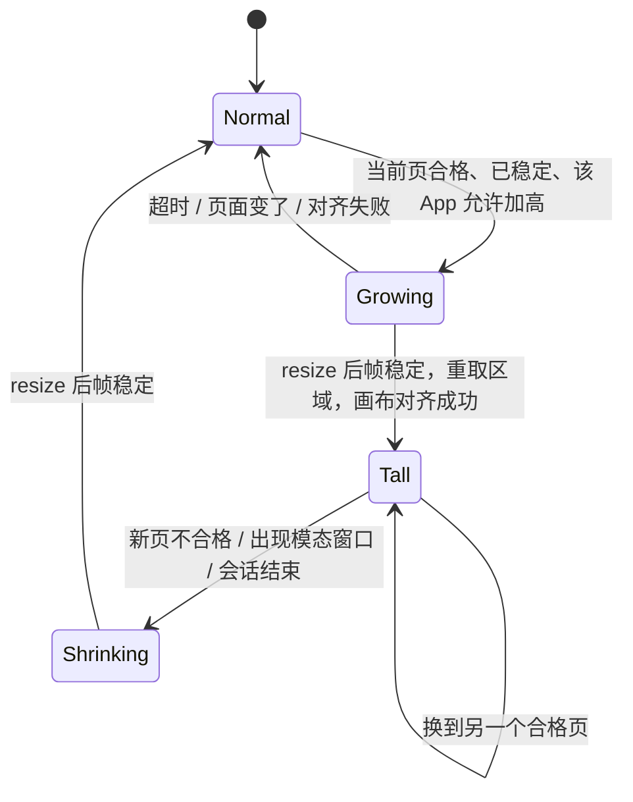

# 30 · 本地滚动、采集头、预取

本篇回答：用户滚动时两端各做什么；B 怎么提前把内容准备好；滚动之后的点击怎么落到正确位置。

## 1. 两个位置

- **A 的视口**：用户正在看的内容范围。只由 A 的输入决定，立刻生效。
- **B 的采集头**：App 真实的滚动位置（加高模式下是一段 k 屏高的范围）。只由 B 的调度器决定。

两者只通过画布发生关系：采集头负责把画布填上，视口负责把画布显示出来。

## 2. A 侧

- 滚轮、触摸拖动、鼠标拖动、自绘滚动条 → 改视口 y → 立刻合成。
- 惯性和越界回弹是 A 自己的动画，不上报，不进协议。
- 视口可以滚进还没探到头 / 尾的未知方向；已知到头的方向在边界停住。
- 画布缺行的地方画占位（区域底色）。占位出现的面积和时长就是“白块”，预取要消灭的就是它。
- 每个渲染帧最多发一条 `View{region, y, vy}`，没发出去的旧值被新值覆盖。

## 3. B 怎么移动采集头

**首选：注入鼠标滚轮事件**，坐标落在滚动区内。

- 预期行为：每个事件滚动固定的像素数，立即生效，没有惯性；鼠标来源在边缘不触发拉伸回弹。各 App 是否真的如此，以探针 P1（[60](60-host.md) §9）的结果为准。
- 一格滚多少像素因容器而异。每个区域第一次滚动时用实际像素位移校准“一格 = 多少 px”，之后按需要的距离换算。
- 每注入一步，下一帧的位移是已知的：先验证“各行是否正好平移了预期的 dy”，通过就直接用；不通过再投票（[40](40-codec.md) §3）。
- 一步走大半屏，一次发一整段新内容。**不要露一行同步一行。**

**回退：分步触摸拖动**（按住 → 分步移动 → 停住再抬起，末速度为零所以不会甩动），并补偿起步的 touch slop。旧项目验证过这种拖动的位移是确定的。某个容器不响应滚轮，或滚轮位移不稳定时，对该区域改用它。

**远距离跳转**（用户把滚动条拖到很远）：连续步进，A 先显示占位。

**禁止**把 A 的拖动或甩动原样转发成 B 的触摸滑动：那会产生惯性和回弹，地图就不准了。

## 4. 调度：采集头下一步去哪

每处理完一帧，按顺序判断，取第一个成立的：

1. 有待执行的点击 → 去能看见点击点的位置。
2. A 视口内有缺行 → 去补。
3. 该页是 `live`，或 `map_exact` 为假 → 跟随 A 的视口。
4. A 在动，运动方向前方、提前量之内有缺行 → 去补（预取）。
5. A 静止，两侧预取距离之内有缺行 → 去补（预取）。
6. 都没有 → 停回 A 的视口位置。

- 第 4、5 条是预取，受 [10](10-dataflow.md) §6 的约束：只在空闲时发、在途量有上限、有输入就停。
- 某方向 `at_top` / `at_bottom` 为真就不再往那边预取。判定到头：A11y 说不能再往该方向滚，或注入滚动后位移为 0。
- **提前量（运动时）**：`ahead_px = |vy| ×（可绘制耗时 P95 + ahead_margin_ms）`。
  可绘制耗时 = 从 B 决定要某一块，到 B 收到这一块的 `Ack`。它包含排队、传输、解码和回程，是偏保守的值，好处是不需要两端对钟。按 App 做滑动统计。
- **预取距离（静止时）**：也以时间计。`该 App 最近的典型滚速 × idle_ahead_ms`。滚得快的 App 自动预取得远。

## 5. 超高虚拟屏

目的：一帧采到 k 屏，预取不用一步步滚；k 屏之内的点击不用先滚动。

**合格页（默认开）**：页面只有一个 `Scroll` 区域，并且它贴到屏幕底边，或者它下面只有一条通栏底栏。

**A 不知道加高的存在。** 换算全在 B：

| 加高帧里的行 | 写到哪 |
|---|---|
| 顶部 `top_h` 行 | 顶栏的 `Fixed` 画布 |
| 中间 | `Scroll` 画布，y = 采集头 y + （行号 − `top_h`） |
| 底部 `bottom_h` 行 | 底栏的 `Fixed` 画布（锚：贴底） |

A 的合成始终是：顶栏 + 滚动窗口 + 底栏贴回。

- `Growing` / `Shrinking` 期间不发任何 `Tx`，A 继续用已有画布。期间到达的点击排队，几何稳定后再执行。
- resize 是一次配置变更：App 可能重建界面、丢掉滚动位置。所以稳定后必须重取 A11y 区域，并用画布对齐重求采集头。A 的视口不受影响。
- 在 `Tall` 状态点开的新页如果不合格（计算器、表单、弹窗），要先缩回 1× 才能出正确的图，这次切换会多等一次 resize。某个 App 这种切换多，就把它的 `tall` 关掉。
- 超出 k 屏范围的预取：在 `Tall` 下继续移动采集头。
- 按 App 记：`tall` 开关、`tall_k`、最近几次 resize 耗时（显示在 l 面板）。探针没通过的 App 默认关。
- `tall` 关闭或页面不合格时，预取只靠第 4 节的采集头移动。

## 6. 点击换算

- 滚动区内的点：屏幕 y = 区域顶 +（内容 y − 采集头 y），在当前采集几何下算。点不在采集范围内 → 先移动采集头。
- 固定区的点：贴顶的直接用；贴底的在加高几何下换到加高屏底部的对应位置。
- 注入前校验（[10](10-dataflow.md) §5）。校验范围：点击点所在 A11y 节点的行范围；没有节点信息就取点上下各若干行。
- 注入后，A11y 的点击事件会报出实际点中的节点。它和预期节点不一致时记一条日志（调试换算用），不影响流程。
- 长按和 `Touch` 流同样换算。`Touch` 流进行中不移动采集头。

## 7. 滚动条

- **App 自己的滚动条**滚动时会出现在右缘，不能进画布。滚动区最右一条窄带（`sb_w`）不参与行 hash，滚动过程中也不写画布；采集头停稳、滑块淡出之后，用那一帧补写这条窄带。补写之前，A 用紧邻左侧一列的颜色填充它。
- **A 自己画的滚动条**：拖它就是改视口。滑块的位置和长度：A11y 给了滚动范围时用它（`Known.total_h`），否则按已知范围估计。它不是 App 的滚动条，不会让任何缓存失效。

## 8. 边界情况

| 情况 | 怎么发现 | 处理 |
|---|---|---|
| 越界拉伸回弹 | 位移验证失败，画面不是整体平移 | 滚轮路径下不应出现。出现了就丢弃这些帧，等稳定帧，再用画布对齐 |
| 残留惯性 | 没注入却还在位移 | 等它停；该区域改用回退拖动，并在 l 面板标出 |
| 折叠标题栏（往下滚时顶栏收起） | 滚动区 rect 在变，或同一帧有两个位移 | 收起过程中的帧不写画布；稳定后重取区域 |
| 吸顶标题、FAB、悬浮按钮 | 滚动区内有一块不随位移移动 | 切成压在上面的 `Fixed` 区域。被它挡住的画布行这一帧不写，等滚开了再写 |
| 列表中间插入 / 删除，条目高度变化 | 对应 y 的行 hash 对不上 | 按差异重发（多半能被 `Copy` 命中），`map_exact` 置假 |
| 无限加载（到底后又长出内容） | `at_bottom` 之后还能滚 | 清掉 `at_bottom`，继续 |
| 下拉刷新 | — | A 的越界只是本地动画，不会触发。要刷新就点 App 自己的刷新按钮 |
| 预取到的位置图片还没加载完 | 停下后仍有原地变化 | 每个预取位置等到稳定再走，等待有上限；没等到的部分以后经过时再补 |
| 预取让 App 多加载数据、多上报曝光 | — | 已知代价。`idle_ahead_ms`、`tall_k` 按 App 可调小 |
| 加高后 App 把非列表部分也拉伸了 | 加高帧的顶栏 / 底栏和 1× 时不一样 | 该页判为不合格，缩回，并记住这个 PageId 以后不加高 |
| 重进页面位置不同 | — | [20](20-pages.md) §4 |

## 9. 横向：tab、Drawer、横向条带（M6）

M6 之前：切 tab 就是一次 `Page{Replace}`，横向条带当普通内容。能用，只是没有滑动动画。

M6 要加的：

- **识别**：A11y 里的横向分页容器（ViewPager 类）、HorizontalScrollView、DrawerLayout。
- **tab**：分页容器的每一页是一个子页面，各有自己的区域和画布；`Page` 增加“兄弟页的左右顺序”。A 横向拖动时用两张已缓存的子页并排平移做动画，松手后给 B 发一次切换。兄弟页没缓存时不做动画，直接切。
- **Drawer**：一个贴边的模态页。A 本地做滑入动画。
- **横向条带**（一行可左右滚的 chip）：`Scroll` 区域增加轴向，画布按 x 寻址，位移投票换成列 hash。
- 协议改动只在枚举末尾追加（区域的轴向、页面的兄弟关系）。
