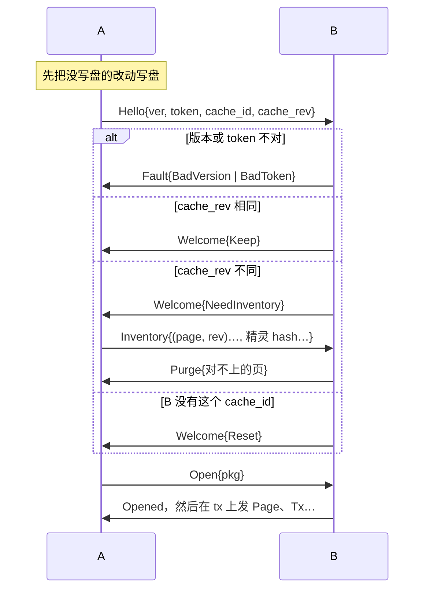

# 50 · 协议与传输

本篇回答：有哪几条流、每条走什么消息；握手和缓存对齐的顺序；传输层要设什么。

类型定义以 `rd/src/wire.rs` 为准，下面是起点。代码落地后，本文只保留规则，字段以代码为准。

## 1. 流

| 流 | 方向 | 内容 |
|---|---|---|
| `ctl` | 双向，A 打开 | 握手、开关会话、调参、统计、故障 |
| `up` | A→B | 输入、视口、确认 |
| `tx` | B→A | 画面数据：`Page`、`Regions`、`Tx`、`PageReset`。**一条有序流** |
| `video` | B→A | M6：视频区的编码帧 |

- 每条消息 = 长度前缀 + postcard（serde）。同一批类型另外导出 JSON，只用于日志、录制和脚本，不上线。
- postcard 不自描述：枚举变体只在末尾追加，字段不增删不改序；不兼容就升 `VER`，握手时版本不等直接拒绝。
- `tx` 上每条消息带递增的 `seq`。

为什么画面数据只用一条流：把可见区和预取拆成两条流，两条流之间到达顺序不确定，同一张画布会被乱序写入，`Copy` 的源也可能先被另一条流改掉。一条有序流没有这些问题；“可见区优先”改由 B 在发送前保证（[10](10-dataflow.md) §6）。

## 2. 消息

```rust
// —— A→B ——
enum Up {
  // ctl
  Hello{ver, token, cache_id, cache_rev},
  Inventory{pages: Vec<(PageId, PgRev)>, sprites: Vec<Hash>},
  Open{pkg, geom: Option<Geom>},  Close,
  Tune{scope: Global | App | Page, key, val},
  // up
  View{page, region, y, vy},
  Tap{page, at: Pt},  LongPress{page, at: Pt},
  Touch{page, phase, at: Pt, dt},       // 非滚动区的拖动；dt = 距上一个采样的时间
  Wheel{page, at: Pt, dx, dy},          // 光标不在 Scroll 区域上时的滚轮
  Back,  Key{code, down, meta},  Text{s},  ClipSet{s},  ClipGet,
  Ack{seq},                             // tx 流上到 seq 为止都已应用
  Persisted{page, rev, cache_rev},      // 已落盘
  Forget{page},  Resync{page},
  VerifyFail{page, region, y0, y1},
}
struct Pt { region, x, y }              // Scroll 区域里 y 是内容坐标

// —— B→A ——
enum Down {
  // ctl
  Welcome{ver, cache: Keep | NeedInventory | Reset, apps: Vec<AppInfo>, params: Vec<Param>},
  Purge{pages: Vec<PageId>},
  Opened{pkg, geom},
  Focus{editable},                      // B 上当前是否有可编辑焦点
  Clip{s},
  Stats{..},  Params{params: Vec<Param>},
  Fault{code, msg},  Replaced,
  // tx
  Page{seq, id, op: Push | Pop | Replace, temp, modal: Option<Modal>, at_root, regions: Vec<Region>},
  Regions{seq, page, regions: Vec<Region>},     // 像素确认后的修正
  Tx{seq, page, rev, ops: Vec<Op>},
  PageReset{seq, page},                         // 该页从空白重新开始（回应 Resync）
}
struct Region { id, kind: Fixed{anchor, z} | Scroll | Video, rect, start_y }
struct Modal  { rect, dim: Rgba }
enum Op {
  Fill{dst, color},
  Lit{dst, enc: Palette | Residual | Raw, dict: Option<Src>, data},
  Image{dst, sprite: Option<Hash>, q, mask, data},
  SpriteDef{hash, w, h, enc, data},  SpriteDrop{hash},
  Copy{src: Src, dst},
  Overlay{id, dst, ops: Vec<Op>},  OverlayDrop{id},  Commit{id},
  Clear{region},
  Known{region, y_min, y_max, at_top, at_bottom, total_h: Option<u32>},
  Verify{region, y0, y1, fold},         // 调试档
}
struct Dst { region, x, y, w, h }
enum Src { Canvas{page, region, x, y}, Sprite{hash, x, y} }
```

`Fault.code`：`BadVersion`、`BadToken`、`OffWhitelist`、`AppGone`、`BlankFrame`、`Stale`、`Busy`。

## 3. 握手与缓存对齐



- `cache_id`：A 第一次使用时随机生成，和缓存一起存在 OPFS。清缓存就换一个。
- 逐页怎么取舍见 [20](20-pages.md) §7。
- 重连到同一个还活着的会话：B 重发返回栈上各页的 `Page`，A 以此重建返回栈。
- 一个 B 同时只服务一个 A。新连接进来 → 旧连接收到 `Replaced` 后被关闭，收到的一方不自动重连。

## 4. 确认

- A 每应用完 `tx` 上的一条消息就回 `Ack{seq}`（累计确认，可以合并发）。
- B 用 `Ack` 做两件事：
  1. 背压：已发未确认的字节超过上限时暂停编码；预取另有更小的上限（`pre_inflight_ms`）。
  2. 统计“可绘制耗时”（[30](30-scroll.md) §4）。
- `Ack` 不参与正确性：同一连接内 A 按序应用，B 发过就算数。
- `Persisted` 才是“盘上有了”的依据（[20](20-pages.md) §7）。
- A 无法应用某个 `Tx` → [10](10-dataflow.md) §7 的 `Resync` / `PageReset` 流程。

## 5. 传输

- **只用 WebTransport**（QUIC），不做 WebSocket 回退。
- **页面在 A 的 localhost 上**（WebTransport 和剪贴板都要求安全上下文，localhost 满足）。B 启动时打印完整 URL：
  `http://localhost:<端口>/#b=<B 的 tailnet 地址:端口>&h=<证书 hash>&t=<token>`
- **证书**：B 自签，ECDSA P-256，有效期小于 14 天（浏览器对 `serverCertificateHashes` 的要求）。证书落盘复用，快过期时换新并打印新 URL。
- **鉴权**：`t` 是 B 生成并持久化的随机 token，随 `Hello` 发送。证书 hash 不是秘密，不能代替 token。
- **监听地址**：只绑 tailnet 网卡和回环，不绑 0.0.0.0。
- **包大小**：Tailscale 的 MTU 是 1280。QUIC 的 UDP 载荷固定在 1200，关掉路径 MTU 探测。暂不使用 QUIC 数据报；以后要用，单个数据报也要守住这个上限。
- **流之间**：B 给 `ctl` 的发送优先级高于 `tx`。浏览器的 `sendOrder` 只影响 A 发出的流，用它让 `ctl` 先于 `up` 即可。
- **保活**：`ctl` 上定期 ping。断线后 B 保留会话 `detach_keep_s`，超时关闭虚拟屏并还原设置。

以后可选的升级：如果实测发现预取数据丢包重传时明显拖慢可见区更新，可以把预取内容改成按 hash 寻址的块走一条低优先级流，放置指令仍走 `tx`。先不做。

## 6. 参数表

参数由 B 发布（`Welcome.params` / `Params`），A 的 l 面板照表画控件，所以加参数不用改页面。
`Param = {key, label, group, val, min, max, step, scope}`。优先级：页覆盖 > App 覆盖 > 全局覆盖 > 按 App 自适应的默认 > 内置默认。B 持久化覆盖值。

| key | 含义 | 起步值 |
|---|---|---|
| `a11y_wait_ms` | 疑似换页后等 A11y 树的上限 | bench 定 |
| `commit_ms` | Overlay 稳定多久后并入画布 | 沿用旧项目的 120 |
| `idle_fps` | 无输入时持续变化区域的更新上限 | bench 定 |
| `sb_w` | 滚动区右缘不参与 hash 的窄带宽度 | 取系统滚动条宽度 |
| `shift_rounds` | 一帧最多认几个位移 | 沿用旧项目的 3 |
| `ibc_min_rows` | 行引用的最短行数 | 沿用旧项目的 16 |
| `block_dp` | 块统计与图片对齐的块边长（按 dp，随屏幕密度换算成像素） | bench 定 |
| `ahead_margin_ms` | 运动时预取提前量里的安全余量 | bench 定 |
| `idle_ahead_ms` | 静止时向两侧预取多远（按时间计） | bench 定 |
| `pre_inflight_ms` | 在途预取量的上限（按时间计） | bench 定 |
| `tall` | 是否允许超高虚拟屏（按 App） | 探针通过的 App 开 |
| `tall_k` | 加高倍数 | 探针给出的可用上限以内 |
| `img_lossy` / `img_q` | 图片是否有损、质量 | 开；bench 定 |
| `zstd_level` | 字面量压缩级别 | 沿用旧项目的 3 |
| `pool_mb` | 精灵池容量 | 沿用旧项目的 64 |
| `cache_mb` | A 的页面缓存容量 | bench 定 |
| `live` | 该页 / 该 App 是否始终跟随视口 | 关 |
| `verify` | 是否附带校验 | 调试时开 |
| `detach_keep_s` | 断线后 B 保留会话多久 | bench 不涉及，先给一个够重连的值 |

“bench 定”的意思：先随手给一个能跑的值，M2 之后用录制数据调，不要在代码里写死。

**按 App 自适应的默认**：B 为每个 App 记几项观测，据此选默认值，结果显示在 l 面板里，用户的覆盖优先。

| 观测 | 影响 |
|---|---|
| A11y 是否可用、有没有给出滚动区和图片节点 | 是否启用区域 / 精灵 / 图片判定 |
| 滚轮探针是否通过 | 采集头用滚轮还是分步拖动 |
| 超高屏探针结果、最近 resize 耗时 | `tall`、`tall_k` |
| 图片面积占比 | `img_q`、`zstd_level`（图片多的 App 压缩级别调低，省编码时间） |
| 典型滚速、可绘制耗时 | 预取距离 |
| 无输入时的变化频率 | 是否默认 `live` |
