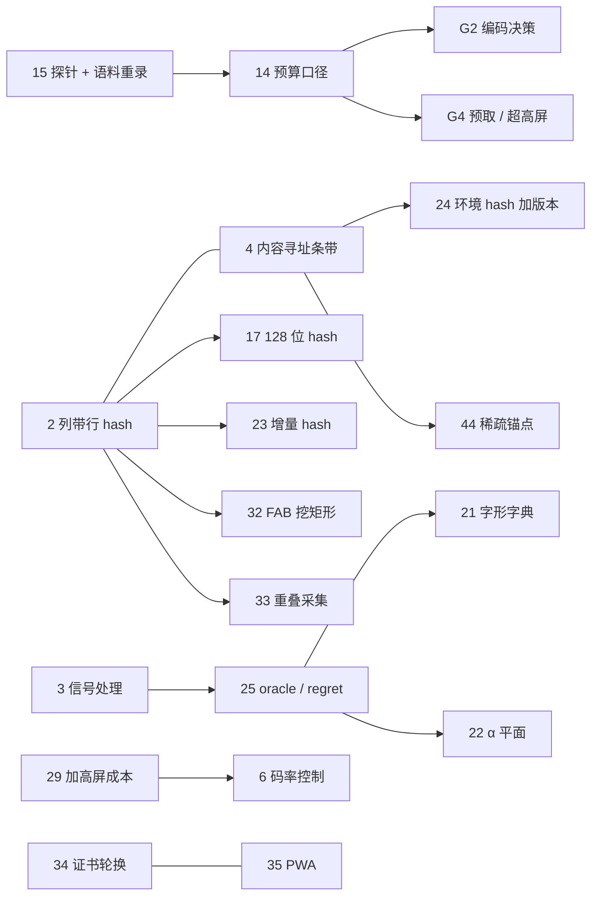

# info-ov.md · info.md 蒸馏版（6 组 / 风险前置 / 冲突优先）

> 来源：`info.md`（43 条，流水号缺 5 与 40；原第 5 条已并入 30，原第 40 条已并入 14）。
> 重排规则：6 个 topic；组按"推翻既有前提的程度"前置；组内先列冲突条，再列依赖后续、再列增量；
> 每条压到 3–5 行：结论 / 冲突 / 动作 / 依据行号。逐字的原文回查 `info.md` 对应编号。
>
> 标签：
> - `冲突` = 与 `GOAL.md`、`doc/10`–`doc/90`、`old/*.md` 相反，或推翻其前提；不改就会返工。
> - `缺口` = 现有文档完全没有、需要新增的规格 / 字段 / 探针。
> - `增量` = 方向一致，只是把参数、语义或边界补细。
> - `HIGH` / `MED-HIGH` / `MED` / `MED-LOW` 沿用 `info.md` 的优先级。

## 0. 跨组前置与硬约束

- **最小单位之争必须先拍**：第 2 条（列带 hash）与第 4 条（内容寻址条带）互相冲突，两个都是 `doc/40-codec.md` §2 的替换方案；17 / 23 / 32 / 33 / 24 / 44 全部以其中一方的结论为前提。
- **第 15 条（三个 M0 探针 + 语料重录）与第 14 条（预算口径）是 G2 / G4 决策的输入**：JPEG 编码速度、DERP vs 直连抖动、A11y 取树耗时，缺任何一项，G2 的压缩档位与 G4 的预取余量都只能是估算。
- **第 25 条是所有识别原语的验收方法**：没有注入增量真值与 oracle 上界，第 3 / 21 / 22 条的收益无法判定，21 / 22 只能停在"要量、不做承诺"。
- **0px 承诺的范围会被 G2 收窄**：第 11 条（阴影层例外）、第 12 条（dim 用 LUT 换回精确）、第 26 条（fg 层不承担逐像素一致）三条合起来重定义了"哪一层必须逐像素一致"。

## 1. 组序与理由

| 序 | 组 | 条数 | HIGH | 冲突 | 为什么排在这里 |
|---|---|---|---|---|---|
| G1 | 寻址与索引 | 12 | 4 | 4 | 改数据模型本身（行 hash / 条带 / 寻址 / hash 位宽），后面的识别、编码、预取全部以它为最小单位；不先定就全部返工 |
| G2 | 编码与保真不变式 | 8 | 6 | 4 | 6 条 HIGH 且直接改 0px 承诺、`Modal` 字段与压缩方向；是"协议级决定"，越早越好 |
| G3 | 协议、语料与度量 | 9 | 2 | 4 | 4 条推翻口径（越界码、48.6% 字节、里程碑次序），其中 15 / 14 是 G2 / G4 的输入；传输细化（18 / 28 / 34 / 35）顺势收在这里 |
| G4 | 采集后端、超高屏与预取 | 5 | 3 | 2 | 与 `doc/90` M4 次序相反（1× 先行），且缺成本模型与带宽项；依赖 G2 的字节预算 |
| G5 | 页面、布局与浮层 | 5 | 2 | 2 | "区域矩形是逐帧数据"与"骨架补救不可用"两条推翻常量假设，但只影响缓存与合成层 |
| G6 | 识别原语与打分 | 4 | 1 | 1 | 纯能力扩展 + 验收方法，收益未测；排在最后是因为它消费 G1 的模型、被 G3 的语料能力约束 |

## 2. G1 · 寻址与索引（12 条）

> 组摘要：这一组只回答一个问题——画布用什么单位寻址、索引怎么建才不爆、哪些像素不参与签名。
> 第 2 与第 4 条是对立的两个最小单位方案，必须先定一个（建议：先定 4 的条带粒度，2 的列带作为条带内部的行签名实现；若两者都要，则条带是存储单位、列带是行签名单位，需在 `doc/40-codec.md` §2 一次写清）。

### 2 · 列带行 hash + 每格有效位 · `HIGH` · `冲突`
- **结论**：行 hash 不覆盖整行，按 4–8 个列带（64 / 128 px）分别算，整行 hash 是列带 hash 的折叠；地图单元从"一行"变成 `(row, band)`，每格带一个有效位——FAB 压住的那一带可单独标"未知 / 固定"，不废整行；右缘滚动条另占一个窄带。
- **冲突**：`doc/40-codec.md` §2 规定"每行一个 64 位 hash、覆盖区域宽度、信息量 = 颜色游程数"；§12 的"按列带引用匹配"是引用层，不是行 hash / 位移检测的基本单位；`doc/30-scroll.md` §8 对 FAB 遮挡是"丢整行"；§11 对重复图案是"放弃投票"。
- **动作**：投票权重改为该行 hash 在上一帧的**稀有度**（逆频率加权），周期性分隔行 / 重复图案几乎不投票；每行附软签名（游程数、平均亮度、若干列带和），精确 hash 被破坏时用 1D 互相关兜底。
- **依据**：`old/llm-think.txt:289-290, :563-567, :1145-1146, :1488, :1749-1750, :2775-2779, :4998`

### 4 · 内容定义切块 + 内容寻址条带 + manifest 作页版本 · `HIGH` · `冲突`
- **结论**：长页按内容边界切（条目间约 8 px 空白行游程，按密度 / DPI 可调，A11y 条目边界作先验；无空白回退 ~256 行固定切，上限 256 行）→ 同一条目在任何 y 得同一 hash，可跨位置 / 跨页 / 跨重进去重；页 = 内容寻址条带的有序列表 + 一个 layout，插入 / 删除 / 重排只改 layout 不重发像素。
- **冲突**：`doc/40-codec.md` §2 明确选相反路线（"行是最小单位，不依赖块大小"）；`doc/70-viewer.md` §6 的 OPFS 按固定行数切块；`doc/20-pages.md` §7 与 `doc/50-protocol.md` §3 是页级计数器 `pg_rev` / `Inventory{pages}`，失配即 `Purge` 整页。
- **动作**：manifest hash 即页版本（两端各自重算，不像计数器会漂移）；版本不一致时按条带比对，只重发 A 最后确认版本之后写过的条带；B 丢状态时 A 在握手时上报条带 hash 清单即可重建，B 不必持久化；A 侧内容寻址块库 + B 发清单 + A 回**缺块位图** → `cache_rev` / `pg_rev` 退化为快路径，A 可自由淘汰。
- **动作（落盘）**：条带必须自包含（不依赖 zstd 上下文与跨条带 IBC 引用）；线上协议保留跨条带上下文，落盘由 A 在空闲 worker 用同一 crate 的自包含 intra 模式重编码。
- **依据**：`old/llm-think.txt:593-604, :1295, :1409-1421, :2781-2785, :3470-3471, :5948-5949, :7212-7219, :2547-2548, :5152-5165`

### 1 · A11y 绝对锚：条目下标 + `ACTION_SCROLL_TO_POSITION` · `HIGH` · `冲突`
- **结论**：RecyclerView / ListView 每个可见 item 的 A11y 节点带 `CollectionItemInfo.rowIndex`（= adapter position，绝对、无漂移），滚动事件还给首 / 末可见 position 与 item 总数 → 画布可按 `(item index, offset within item)` 寻址，而不靠累计像素；`ACTION_SCROLL_TO_POSITION` 让采集头零偏移跳到指定下标（滚动条远跳、点屏外条目不必连续步进）。ScrollView 的滚动事件直接给绝对 `scrollY` / `maxScrollY`，RecyclerView 的 `scrollY` 恒为 0。
- **冲突**：`old/llm-goal1.md` §5 风险 5"RecyclerView 无绝对偏移：只有 delta，累计会漂移"的前提是错的——无绝对量的是滚动 delta，不是条目下标；`doc/` 继承了它。
- **动作**：`doc/20-pages.md` §4 内容坐标加 item index 层；`doc/60-host.md` §5 字段加行号 / item count / 首末可见 position / 滚动动作；`doc/30-scroll.md` §3 远跳加 `ACTION_SCROLL_TO_POSITION`；`doc/80-corpus-bench.md` §3 录制加 collection info（uiautomator 的 XML dump 会丢掉它）。注意 `TYPE_VIEW_SCROLLED` 被节流到 ~100 ms 并累加 delta → 交叉校验只能在页面停稳后做，不能逐帧比。
- **依据**：`old/llm-think.txt:2253-2258, :5119-5122, :5610-5612, :7177-7178, :8054, :8455, :9179-9183`

### 16 · 滚轮注入的精确像素公式 · `HIGH` · `冲突`
- **结论**：框架把 `AXIS_VSCROLL` 轴值乘 `getScaledVerticalScrollFactor()` 后取整成像素；默认垂直因子 = **64dp × density**（420dpi → **168 px/轴单位**），NestedScrollView 用 theme 的 list item height（基准不同 → 因子按容器类不同）。要精确 N 像素：轴值取 `(N + 0.5) / factor`（同时命中截断与取整两种实现）。配 `SOURCE_MOUSE`：不触发拉伸回弹，RecyclerView 也不触发 fling → 一次事件 = 确定的一步。
- **冲突**：`doc/30-scroll.md` §3 只有"每个区域第一次滚动时用实际像素位移校准"（经验标定）；`doc/60-host.md` §6 无因子常量与命中公式，§9 的 P1 只按 App 主列表测一次。
- **动作**：探针按页 / 按容器做——每页入口注入一个已知像素量，用像素投票判定响应属于 **精确 / 有动画 / 不支持**（Compose `Modifier.scrollable` 可能对滚轮做动画），再决定用滚轮还是零末速拖动。
- **依据**：`old/llm-think.txt:3964-3969, :3691-3692, :5211-5218, :2271-2272`

### 17 · 128 位持久内容 hash（64 位只用于帧内校验） · `MED` · `增量`
- **结论**：64 位在约 10⁷ 条带上生日界约 3e-6，帧内可忽略；但跨会话持久引用不行——B 无法对 A 存的像素逐字节比对，只能信 hash → 持久条带缓存用 **128 位**。帧内校验（两端都持像素、可 memcmp）用 64 位即可。
- **冲突**：`doc/40-codec.md` §2 只规定 64 位；`doc/20-pages.md` §7 的持久化版本对齐未涉位宽。
- **依赖**：与第 4 条配套才成立。
- **依据**：`old/llm-think.txt:7187-7190`

### 44 · 归一化互相关回退 + 稀疏锚点索引 · `MED` · `缺口`
- **结论**：(a) 预测位移失败时回退到行签名的**归一化互相关**投票，比纯 hash 匹配更容忍轻微拉伸、重采样、亚像素位移。(b) 不给每行建索引，只保留"行 hash 命中固定余数"的内容定义**锚点**，索引体积缩约 **32×**，winnowing 保证锚点最小密度 → 回到页面时用首屏一小段 hash 即可在页面地图里定位，**与是否对齐无关**；页面查找同理用 anchor hash 投票。
- **冲突**：`doc/40-codec.md` §3 只有"整表 + 投票"，无互相关回退、无锚点 / winnowing。
- **依赖**：第 30 条要"查全局索引"，本条给"索引怎么建才不爆"。
- **依据**：`old/llm-think.txt:2069-2073, :2325-2327, :6228-6232`

### 23 · 增量行 hash + 零拷贝读帧（加高屏下是 CPU 预算问题） · `MED` · `缺口`
- **结论**：加高到 3× 屏高后逐帧全量算 hash 会吃满 CPU。做法：ImageReader 的 RGBA buffer 在 JNI 侧**就地读**（零拷贝）；memcmp 把每个行带与上一帧比对，只有变化的行才重算 hash；SIMD 一次算多条 64 位。数字：3× 屏高一帧约 **34 MB** RGBA；hash 约 **6.6 ms/帧**；ImageReader 没有 damage 信息 → 每帧都得扫。
- **冲突**：`doc/60-host.md` §3 只写"回调里只取最新一帧、去掉行跨距后交给 rd"；`doc/40-codec.md` §2 只定义语义，无增量哈希 / 零拷贝约束与"加高后成本 ×k"的预算说明。
- **依据**：`old/llm-think.txt:4326-4327, :4310, :2289-2290`

### 32 · 悬浮控件矩形从行 hash 里挖掉（不只是不写画布） · `MED` · `缺口`
- **结论**：FAB 压住的内容会混进被压行的**行签名**，使该行 hash 随 FAB 状态失配——哪怕那行其实没变。做法同右缘滚动条带：把这些矩形从行签名计算范围里裁掉（只从"该控件不在此行"的帧取像素）。
- **冲突**：`doc/40-codec.md` §2 只裁 `sb_w`，其余按区域宽度；`doc/30-scroll.md` §8 只解决"不写"，没解决"不参与 hash"。
- **依赖**：与第 2 条的列带有效位配套后价值最大。
- **依据**：`old/llm-think.txt:9299-9300, :9312-9313`

### 33 · 滚动条窄带靠重叠采集重建，不必等淡出 · `MED` · `缺口`
- **结论**：让相邻两次采集的重叠量 ≥ 滑块长度 → 每条内容行至少有一次没被滑块压住，可从那一次取干净像素。配套事实：滑块淡出由 ViewConfiguration 驱动（约 **300 ms 延迟 + 250 ms 淡出**），**不随动画缩放缩短** → "等淡出"的延迟是固定的，关动画也没用。
- **冲突**：`doc/30-scroll.md` §7 只有"停稳、滑块淡出后用那一帧补写窄带"。
- **依据**：`old/llm-think.txt:3248-3252, :3518`

### 24 · 缓存命名空间补 App 版本 · `MED` · `缺口`
- **结论**：渲染环境 hash 要加 **App 版本码**。App 更新后旧缓存仍会命中——hash 校验能挡错像素，但乐观返回会闪旧内容，旧缓存还白占存储。
- **冲突**：`doc/20-pages.md` §2 几何键只有虚拟屏宽 / dpi / 字体缩放 / 深浅色；`doc/80-corpus-bench.md` §3 的 manifest 反而已记包名与版本，两头不一致。
- **依据**：`old/llm-think.txt:2544-2545`

### 41 · A11y dump 绑采集帧序号 + 分割结果的有效范围 · `MED` · `缺口`
- **结论**：每次取到的节点树打上对应**采集帧序号**；由它推出的区域分割**只对"其后没有内容变化"的帧有效**，且分割边界须与像素不连续处对齐，否则 A11y 会把错误内容框住。取树在 binder IPC 上要走几十毫秒 → 只在 content-changed / scrolled / window 事件去抖后重取。
- **冲突**：`doc/60-host.md` §5 与 `doc/10-dataflow.md` §1 只有"时间戳"，没有帧序号绑定与有效范围规则。
- **依据**：`old/llm-think.txt:3404-3409`

### 43 · 区域"同 bounds 合并"规则 · `MED` · `缺口`
- **结论**：语料里多区域页只有两种形态——(a) ScrollView 套 ScrollView（razr 设置页；主页是 ScrollView 套 GridView）；(b) ScrollView 套 ViewPager 套列表（libchecker），后者 ViewPager 与 RecyclerView 与外层 ScrollView 同 bounds。规则：**bounds 相同即合并成一个区域**，"多区域"其实来自外层那条全屏 ScrollView。
- **冲突**：`doc/20-pages.md` §3 只有"只取面积最大的那条纵向滚动链"；`doc/30-scroll.md` §9 把横向容器推到 M6，无同 bounds 合并与实测形态清单。
- **依据**：`old/llm-think.txt:8809-8815, :9155, :9226-9230`

## 3. G2 · 编码与保真不变式（8 条）

> 组摘要：这一组重定义"哪一层必须逐像素一致"，并把压缩档位从旧的局域网判据换成 300–800 KB/s 的判据。
> 0px 承诺在此收窄为：bg / lit 两层 + 阴影层与 fg 区例外；dim 通过 LUT 从"放弃精确"变回"精确"。

### 9 · 压缩强度按链路 backlog 自适应（旧结论在新链路上是反的） · `HIGH` · `冲突`
- **结论**：旧判据是局域网。在 300 KB/s 上：整屏文字帧 WebP-lossless 编码约 **196 ms**，省下的 ~80 KB 相当于线上 **~267 ms** → 编码耗时被传输节省摊平；盈亏平衡约 440–450 KB/s，而目标链路只有 300 KB/s。zstd-3 → zstd-9：157 KB → 126 KB，多花 20–50 ms 换 ~20% 字节。
- **冲突**：`doc/50-protocol.md` §6 写 `zstd_level` 沿用旧项目 3，且"图片多的 App 压缩级别调低、省编码时间"——**新链路上方向相反**；`old/10-codec-modules.md` 保留"WebP 无损不可用"。
- **动作**：`zstd_level` 随发送队列自适应；按条带并行编码（8 核：196 → 25–40 ms）与发送流水重叠，每 1 ms 编码约值 300 字节流量；每 App zstd 字典（作用在索引平面）先测 repcode 命中率，只有再省 ≥10% 才建。
- **依据**：`old/llm-think.txt:1983-1993, :2587-2597, :3667-3668, :610-616`

### 11 · 阴影是"位置相关像素" → 单列一层，允许非 0px · `HIGH` · `冲突`
- **结论**：Material / M2 的 elevation shadow 按**行在屏幕上的位置**渲染（光源相对屏幕固定），同一段内容在两个滚动位置像素不同 → 破坏整行 hash 的精确匹配。已拍板：阴影**单独一层**，该层允许非 0px——不参与行 hash、不进逐像素校验，可按有损 / 近似编码合成；其余层保持 0px。
- **冲突**：`doc/40-codec.md` §6 把阴影归入"渐变 / 阴影 / 颜色多但不是照片"→ `Lit{Residual}`（按无损处理）；§2 行 hash 覆盖整行；§10 的校验跳过项没有阴影层；IDEA"其他层 0px"需打一个例外。
- **动作**：校验掩码新增"阴影层"跳过类（沿用 `Image` 置位、`Fill`/`Lit` 清零、`Copy` 跟随那套机制）；M0 量一次位置相关像素占比（M3 card 基本已去掉 spot shadow，HyperOS / AOSP 设置较平，但仍需实测以定容差与收益）。
- **依据**：`old/llm-think.txt:6494-6516`

### 26 · 有损层用浏览器原生解码器；fg 可放弃逐像素一致 · `HIGH` · `冲突`
- **结论**：fg 是独立合成的一层，B 从不需要 A 的 fg 像素 → A 端直接用 `createImageBitmap` / `ImageDecoder` 解码，rd 里不必带 JPEG 库；"0px 不变式"缩到 **bg / lit 两层**。
- **冲突**：`doc/40-codec.md` §7 要求两端同码（纯 Rust JPEG，bench 也用它）；§10 已排除有损像素但没有层级规则；`doc/70-viewer.md` §3 合成顺序未区分 fg 与 bg / lit 的保真要求。
- **连带**：B 无法预知浏览器解码结果 → 有损区必须**始终**排除在行 hash 与校验之外（B 按源像素算 hash，A 无从复现）；bench 口径不变："有损区之外逐像素一致"。
- **依据**：`old/llm-think.txt:8203-8207, :8215-8219`

### 12 · Dim（模态压暗）用 3×256 逐通道 LUT 精确表达 · `HIGH` · `冲突`
- **结论**：固定 scrim + 固定 alpha 的混合是**逐通道点到点映射**（黑色 scrim 时就是输入的定比缩放）→ 每通道一张 256 项表即可精确描述，delta 后三表约百字节（推算，未实测）。压暗必须在**合成时**施加，不能烘进画布（否则关弹窗后底图已被压暗，无法还原）；若合成器用了 dithering 或跨通道混合，回退稀疏残差列表。
- **冲突**：`doc/20-pages.md` §6 与 `doc/50-protocol.md` §2 的 `Modal{rect, dim: Rgba}` 只是一个颜色；`doc/40-codec.md` §10 把压暗背景整体排除在校验外（放弃精确）→ 本条把精确性拿回来。
- **动作**：`Modal.dim` 从 `Rgba` 改为 3×256 LUT。另一方向的量化（两端跑同一整数混合 + 稀疏残差保 0px）代价约 0.2 bit/px、2.6 MP ≈ **65 KB**，接近整页重发 → 做成可调项、近似模式默认关。
- **依据**：`old/llm-think.txt:8231-8241, :8946-8951, :5021-5030, :7392-7399`

### 8 · 调色板必须降到条带级 + token 流 + 两级种子表 · `HIGH` · `冲突`
- **结论**：整屏色数中位 **636**（razr）/ **300**（xiaomi），≤256 色的帧只有 **8% / 32%** → "整屏一个 8-bit 调色板"在真实 App 上不成立。每条带用局部调色板 ≤256 项（索引正好 1 字节），超限回退残差编码、rare 色走 escape 像素。
- **关键**：索引不是序数关系，PNG 式预测滤波会让它变大 → 按**亮度排序**调色板，索引平面编成行内 RUN + `COPY_ABOVE` token 流再过 zstd（顺带匹配跨条带的重复字形行）。
- **两级**：App 级**种子表**（主色、表面色变体、文字色）随缓存持久化；每条带只存相对种子的增量，纯色填充直接指向种子索引。旧"≤16 色"阈值被否：HEVC-SCC palette 上限 63 项 + escape，AA 文字灰阶远多于 16。
- **冲突**：`doc/40-codec.md` §6 只写"矩形内调色板 + 索引平面 + zstd"（无上限、无回退、无 token 层）；§12 只把"页级共享调色板"列消融候选。分类阈值按实测 regret 定，不写死，且要进 `doc/50-protocol.md` §6 参数表。
- **依据**：`old/llm-think.txt:7086-7093, :7435-7436, :7529, :7860, :8056, :8060-8067, :6205-6209, :6554-6558`

### 10 · 有损图片两档阶梯 + 首屏交付顺序 · `HIGH` · `缺口`
- **结论**：图片只做两级——先半尺寸或 q≈35 的**预览**，再目标质量；精修排队进预取优先级（条件是目标质量字节估算仍高于阈值）。**页内字节顺序固定**：底色 / 骨架 solid rect（点击立刻有反馈）→ 文字条带自上而下 → 图片（先预览后终稿）。远处预取只发低质量，滚到可见且管线空闲时**整块替换**为全质量（不需要精确增量）。
- **冲突**：`doc/40-codec.md` §7 只有单档 `Image` + `img_q` + 掩码；`doc/10-dataflow.md` §6 只区分"可见区优先"，无页内交付顺序。
- **动作**：色度采样按区域选——4:2:0 会糊掉图内彩色细边，小图标可能要 4:4:4，照片可留 4:2:0。
- **依据**：`old/llm-think.txt:2390-2398, :2921-2923, :6533-6537, :6055-6056, :3357-3358`

### 27 · fg 合成协议：bg 条带开"洞块"，tile id 参与条带 hash · `MED` · `缺口`
- **结论**：每条带同时列"有损 tile 摆放"与无损块，bg 平面上的**洞块**让下面的 tile 透出来；圆角图标的整个包围盒按 JPEG 编，边界块用便宜平色填充，再由 bg 平面用精确的按块掩码盖回；tile id = 源像素 hash（同 id 的高质量版本直接替换低质量版本）。条带 hash 必须覆盖**无损平面 + 洞掩码 + tile id**，两端解码后互校。
- **代价（明确接受）**：分类参数一改 hash 就变，调过参的页缓存失效。
- **冲突**：`doc/40-codec.md` §7 只有"与底色相同的像素用 1 位掩码标出"；§2 行 hash 只覆盖行像素。
- **依据**：`old/llm-think.txt:8209-8212, :8399-8403`

### 37 · 两段式图片投递 + 占位分辨率 · `MED` · `缺口`
- **结论**：先发 1/4 分辨率占位（**仅当**估算传输时间超过约 **100 ms** 预算时才发），再升级全尺寸；滚动跟不上链路时同理先发低分辨率条带、滚慢后换精确内容（= tile 地图"粗 tile → 细 tile"策略用到图片与滚动）。
- **冲突**：`doc/40-codec.md` §7 无渐进档；`doc/30-scroll.md` §2 的占位只是区域底色纯色块。
- **注**：与第 10 条同族，可合并实现。
- **依据**：`old/llm-think.txt:1744-1745, :1840-1841`

## 4. G3 · 协议、语料与度量（9 条）

> 组摘要：这一组是可当验收线的数字与"旧数字不可用"的结论，外加传输层细化。
> 15 与 14 是全局输入：没有它们，G2 的档位与 G4 的余量都只是估算。

### 15 · 三个缺失的 M0 探针 + 语料必须重建 · `HIGH` · `缺口`（全局前置）
- **结论**：P1–P8 缺三项，都是设计参数的前置条件：① 手机端 JPEG 编码速度（libjpeg-turbo + NEON 估 50–100 MP/s，整屏 2.6 MP ≈ 30–50 ms，需实测）；② Tailscale 直连 vs DERP 中继各自的速率与抖动（DERP 的 P95 抖动大 → 余量参数要自适应）；③ 在虚拟屏上取 A11y 树的耗时（数十 ms binder IPC → 决定树快照能否异步化而不拖慢像素管线）。
- **结论（语料）**：旧语料约 **48.6%** 下行字节是退到桌面的壁纸帧，单 App 会话不会产生 → **语料必须重录**，旧数字不能直接进预算。
- **冲突**：`doc/60-host.md` §9 的 P1–P8 含熄屏（P7）、IME（P4），没有这三项；`doc/80-corpus-bench.md` §2 说要重录但没给"旧字节里有多大比例不可用"的量级。
- **依据**：`old/llm-think.txt:1563-1570, :3404, :3667-3668, :5407-5408`

### 14 · 语料与 bench 的量化口径（可直接当验收线） · `HIGH` · `冲突`（全局前置）
- **结论（预算）**：首屏 300 KB/s × 300 ms ≈ **90 KB**（p90）；文字页无损 71–157 KB → 2–4 屏/s，照片页 0.7–2.3 MB → 0.13–0.45 屏/s。**延迟目标是首屏与换页，不是滚动**。采集头上限 1× 约 **57,600 px/s**（0.8 屏/步 × 30 步/s，仅上界）；文本列表瓶颈是 App 渲染 / 采集 60 fps，不是带宽。
- **结论（覆盖率）**：402 个 App dump 的滚动区形态 ≈ 32% 无滚动区 / 33% 单区贴底 / 16% 单区带底栏 / 18% 多区（多区中 42/71 嵌套）→ 加高屏合格页只覆盖约一半，**采集头扫描必须作为并行路径存在**。
- **结论（归因被推翻）**：451 个 dump 里 49 个（11%）根包名非目标 App，但其中 30 个是**另一个白名单 App 在前台**（采集脚本没把目标 App 拉回前台 = 标签错位），真越界 19 个 ≈ **4.2%** → `Fault.code` 应从 `OffWhitelist` 改为 **`OffSession`**（判据"前台包名 == 会话 App"）；会话身份绑到**任务 / 根 Activity**，不是栈顶包名。
- **冲突**：`doc/80-corpus-bench.md` §6 有指标与网络档，但无字节预算、无 time-to-first-paint、无"每屏字节 → 屏/秒 → 采集头 px/s"换算；§2 有规则无量化；`doc/50-protocol.md` §2 仍是 `OffWhitelist`。
- **依据**：`old/llm-think.txt:1210-1211, :1462-1463, :8096-8108, :8372-8375, :8572-8579, :8640-8644, :8806-8815, :8974-8977, :4050-4051, :4584-4586`

### 38 · 旧字节口径必须重算：`back` 的 48.6% 是桌面壁纸 · `MED` · `冲突`
- **结论**：旧基线 `back` 类占下行 **48.6%**，看着很吓人，但多数是 App 退到桌面后的**桌面壁纸**（旧 `back` 帧里 21/87 超过 2 万色，最大一帧就是壁纸），单 App 会话的新设计根本不产生。做容量 / 预算前必须先按"栈顶包名 != 会话 App"打 `in_scope=false` 剔除再重算。
- **冲突**：`doc/80-corpus-bench.md` §2 已有"越界帧打标剔除"与"每帧记实际栈顶包名"两条规则（现在 `app` 字段记的是"打算采的 App"）→ **规则有、量化结论缺**。
- **依据**：`old/llm-think.txt:4050-4051, :4584-4586`

### 45 · 有损图片路径必须前移到早期里程碑 · `MED` · `冲突`
- **结论**：照片类矩形占语料**面积 ~52%、字节 ~73%** → 图片编码排在最后会让其它优化的测量全被照片字节淹没。次序原则：**先建内容寻址 tile store，再叠滚动识别与预取**。
- **冲突**：`GOAL.md` §6 与 `doc/90-tasks.md` M5（任务 50"图片：判定、有损编码与掩码"）把图片排最后——是规划性变更，需显式决定，不能默默改。
- **依据**：`old/llm-think.txt:6699-6701, :753-757`

### 39 · 用法加权主指标：每分钟字节数 + 按交互类别拆解 · `MED` · `缺口`
- **结论**：主指标应是**一段脚本化真实会话的每分钟字节数**，按交互类别拆：**首访 / 回访 / 新滚 / 回滚 / 点击**；退到桌面的帧标越界不进统计。这是对 300–800 KB/s 约束的直接回答："一个人正常用这个 App，每分钟花多少 KB"。
- **冲突**：`doc/80-corpus-bench.md` §6 只有按场景 / 层 / Op / 步骤的字节、白块指标、影子编码省流，无用法加权速率与交互类别分类法。
- **依据**：`old/llm-think.txt:335-340`

### 18 · 视口位置走 QUIC 数据报（latest-wins 绝对值），最终位置走可靠流 · `MED` · `增量`
- **结论**：A→B 的视口位置是绝对值 `View{region, y}`，后条覆盖前条、丢一条无代价 → 30–60 Hz 走**不可靠数据报**，高频更新不排队；手势结束的**最终静止位置**必须走可靠流。尺寸运行时读 `maxDatagramSize()`（Tailscale 1280 MTU → IPv6 UDP 载荷约 1232 B，扣 QUIC / AEAD / WebTransport 开销后约 **1100 B**），不写死。
- **冲突**：`doc/50-protocol.md` §5"暂不使用 QUIC 数据报"→ 本条把"以后"具体化（哪条消息走、什么语义、哪条必须可靠）；`doc/10-dataflow.md` §6"每帧最多一条 `View`"已暗示语义但没落到传输层。
- **依据**：`old/llm-think.txt:2414-2415, :2736-2737, :5576-5583`

### 28 · 下行发送分级 + 8–16 KB 消息粒度 + 服务端 QUIC 流优先级 · `MED` · `增量`
- **结论**：优先级四级：**控制 → 精确可见补丁 → 有损图片与精修 → 预取与投机**；每条消息 **8–16 KB**，让可见补丁不长时间排在已发出的低优先级负载后面；优先级设在 **B 自己的 QUIC 发送流**（quinn / wtransport 的 `SendStream::set_priority`）——浏览器 `sendOrder` 只管浏览器自己发起的流。
- **冲突**：`doc/50-protocol.md` §5 已写"`ctl` 高于 `tx`"与 `sendOrder` 适用范围；`doc/10-dataflow.md` §6 已写"可见区永远优先、一次只发一小段"→ 原则已有，缺四级阶梯与 8–16 KB 粒度。
- **依据**：`old/llm-think.txt:261-265, :489-493`

### 35 · 手机当 A：PWA 从任意 HTTPS 源连接 · `MED` · `缺口`（产品形态入口）
- **结论**：WebTransport + `serverCertificateHashes` 在**任何安全上下文**可用 → A 是手机时不必自建 localhost 静态服务器，任意 HTTPS 源托管 PWA 直连 B 即可（剪贴板在 HTTPS 源下同样是安全上下文）。
- **意义**：把项目形态从"本机调试工具"扩到"任何设备打开一个网页就能看 B 的屏幕"，并回答 `GOAL.md` §7 第 6 条（"手机当 A 时 localhost 页面由谁提供"标的"未定"）；与第 34 条合成"远端接入"这条链路的最后两块拼图。前提：源必须 HTTPS，明文 HTTP 的 tailnet 地址不是安全上下文。
- **冲突**：`doc/70-viewer.md` §1"必须是 `http://localhost`，否则 WebTransport 和剪贴板不可用"。
- **依据**：`old/llm-think.txt:3595-3596`

### 34 · 证书轮换免重配对 · `MED` · `缺口`
- **结论**：自签证书有效期 < 14 天，换证后老 URL 失效。做法：每次连接时 B 在控制通道**预告下一个证书的 hash**，A 把当前 + 下一个一起交给 `serverCertificateHashes` → 轮换不要求用户重新配对。更彻底：A 连接前从 B 的 tailnet 地址用明文 HTTP 取当前 hash（需验 CORS 与 Private Network Access 放行）→ 不需要轮换协议；该 hash 不是秘密（任何能连到端口的设备都能从握手算出），鉴权仍靠独立 token。
- **冲突**：`doc/50-protocol.md` §5 现状是"证书落盘复用，快过期时换新并打印新 URL"→ 要求用户换 URL。
- **依据**：`old/llm-think.txt:3437-3449, :7158-7168, :7563-7565`

## 5. G4 · 采集后端、超高屏与预取（5 条）

> 组摘要：这一组决定"像素从哪来"和"跟不上时怎么办"。
> 核心次序变更：1× 采集头扫描是基线先做（无平台风险），加高倍数由 bench 页面模拟器比白块率定 `tall_k`——与 `doc/90` M4 的现有次序相反。

### 29 · 超高虚拟屏的成本模型 + 改高度的方式 + 逐页前置判定 + 1× 先行 · `HIGH` · `冲突`
- **结论（成本）**：1080×9600 RGBA ≈ **41 MB/帧**，四缓冲 ≈ **166 MB**；每帧多哈希 9600 行 ≈ **+9 ms**；高度受 GPU 最大纹理封顶（3× = 1080×7200 通常可，4× 可能超 8192）；每次 resize 都是一次配置变更 → App 重建界面、丢滚动位置。
- **已拍板（怎么改）**：**优先在活动之间修改屏幕高度，单个活动内高度不变**——进入某活动后全程固定高度，避免同活动内反复配置变更与重建，同活动页面共享几何键与缓存；活动内确需换高度才 resize。替代路线"永远固定一块高屏、只改屏内任务 / 窗口边界"同样会重建未声明 `configChanges` 的 Activity。
- **动作（前置判定 + 验证）**：加高前查目标 Activity 是否声明 `screenSize` 等 `configChanges`（PackageManager 可报）→ 声明了便宜，否则退回"整会话固定高度"；**先做 1× 采集头扫描基线**，再用 bench 页面模拟器比较 1 / 2 / 3 倍白块率定 `tall_k`，不靠直觉。
- **冲突**：`doc/30-scroll.md` §5 只有 Growing / Tall / Shrinking 状态机与副作用，无内存 / 哈希成本、无"活动之间改高度"规则；`doc/60-host.md` §9 P3 只问"最高能加几倍"；`doc/90-tasks.md` M4 先做状态机（42）再做 bench 模拟（43）→ 次序相反。
- **依据**：`old/llm-think.txt:7007-7008, :7345-7350, :3224-3238, :2934-2935, :2289-2290`

### 6 · 预取是码率控制问题，不只是调度问题 · `HIGH` · `冲突`
- **结论**：一旦 `滚速 × 每像素字节 > 链路速率`，再多提前量也追不上，只能露白块。最大可持续滚速：300 KB/s、文字列表 42–58 B/行 → 约 **5000 px/s ≈ 2 屏/s**；图标密集列表掉到 1 屏/s 以下。
- **动作**：供给不足不排队，走**保真度降级阶梯**（先半分辨率 / 模糊预览，管线空闲再锐化）；视口滚到"已收到内容的边缘"用**软墙**减速 + 给部分 tile 填区域底色，不直接露白块；**两遍预取**：先发便宜的文本层（20–40 B/行）把前沿推出去，重内容随后补；指标加"**软墙卡住用户的时长**"，比白块率更能说明预取是否跟得上。
- **冲突**：`doc/30-scroll.md` §4 的 `ahead_px = |vy| ×（可绘制耗时 P95 + ahead_margin_ms）` **不含带宽项**；§2 既定行为是"允许滚进未知方向 + 画占位"，无减速；`doc/10-dataflow.md` §6 只限在途字节上限；`doc/80-corpus-bench.md` §6 有白块指标无软墙时长。
- **依据**：`old/llm-think.txt:5065-5072, :3647-3653, :6093-6097, :6799-6800, :7130-7131`

### 7 · ScrollCapture：超高虚拟屏之外的第三条预取后端 · `HIGH` · `缺口`（需先探可用性）
- **结论**：Android 隐藏接口 `requestScrollCapture`（SystemUI 长截屏那条路）可让框架把滚动容器的**屏外内容**渲染进我们提供的 Surface；期间临时关掉 overscroll 与垂直滚动条，结束恢复滚动位置。优点：不改虚拟屏几何（不触发配置变更 / 重建 / 丢位置）、条带是**精确内容坐标**、只画该 View（FAB / 底栏天然不参与）。
- **约束**：只支持 ScrollView 类 / ListView / RecyclerView 类 / WebView，App 可自带 capture callback；需 `READ_FRAME_BUFFER`（shell manifest 已声明）；捕获期间视图**真的在滚动** → 注入点击前必须先结束 session；隐藏 API 在 app_process / OEM 上是否可用要探（落成 `doc/60-host.md` §9 的新探针）；透明 RecyclerView 的窗口背景可能漏。
- **动作**：`Prefetcher` 三种后端按区域逐个尝试，1× 滚轮采集头作基线先做。
- **冲突**：`doc/30-scroll.md` §5 只有"超高虚拟屏"这一条预取后端；`doc/60-host.md` §9 无对应探针。
- **依据**：`old/llm-think.txt:5090-5111, :5410-5417, :5506-5516, :5629-5633, :7352-7356, :7791-7795, :7949-7950, :8936-8940`

### 20 · 甩动落点预测式预取 · `MED-HIGH` · `缺口`
- **结论**：A 端本地跑惯性物理算出甩动落点并**提前**告诉 B；B 直接跳到落点、优先预取落点区，之后回补甩动途中掠过的内容；调度按"视口何时到达该块"与"送达需要多久"排序，来不及的块推入空闲回填队列。
- **冲突**：`doc/30-scroll.md` §4 采集头调度只有"运动方向前方 + 提前量"与静止两侧预取；§3 的"远距离跳转"仅指滚动条拖拽。
- **依据**：`old/llm-think.txt:1116-1120, :1527-1528`

### 42 · 看门狗进程还原系统设置 · `MED-LOW` · `缺口`
- **结论**：现有三处还原（正常退出 / 崩溃处理器 / 下次启动兜底）之间有空窗：host 被厂商后台管理杀掉又没触发崩溃处理器时，设置会一直保持被改状态。补一个 watchdog 进程：shell 循环监视 host PID，PID 消失即刻还原动画与模糊缩放（读 `/data/local/tmp/hj/restore.json`）。
- **冲突**：`doc/60-host.md` §2 依赖三处还原；§8 已列"host 无声消失"这个症状，但无还原手段。
- **依据**：`old/llm-think.txt:5194`

## 6. G5 · 页面、布局与浮层（5 条）

> 组摘要：页面身份与布局的假设要改三处——区域矩形是逐帧数据（不是常量）、骨架 hash 的补救在设置类页面上不可用、悬浮 / 模糊浮层需要解混或明确近似。
> 这组不阻塞 G1 / G2，但决定缓存命中率与"能 0px 还是只能近似"。

### 30 · 页面身份：像素为主，骨架降级为"分区 / 确认" · `HIGH` · `冲突`
- **结论**：A11y 树晚到（每节点 50–300 ms IPC）→ 像素先跑：算新帧行条带 hash，查**持久化的 per-App 行段索引**，多数条带命中同一已知页即认定该页并复制其缓存；骨架 hash 只用于分区、确认、以及预测"点这个条目会去哪"。
- **算法（两级查找）**：骨架把候选页**分桶** → 桶内用首帧行 hash 投票选最佳匹配（滚动位置不同也能认出同一页）；缓存键 = "包名 + Activity + 标题"下挂**多个布局变体**，变体按像素行 hash 重叠度挑 → 碰撞只浪费字节，不影响正确性。
- **冲突**：`doc/20-pages.md` §2 的 PageId 原则一致（"是不是同一页由像素决定"），但没有全局行哈希索引 + 桶内投票；§9 的补救是"把能区分它们的文本加进 PageId"，而实测标题常在滚动区里取不到、设置子页共用骨架 → 该补救在设置类页面上不可用。
- **依据**：`old/llm-think.txt:173-176, :508-513, :4069-4073, :4654`

### 31 · 折叠标题栏 → 区域矩形是逐帧数据，不是页面常量 · `MED-HIGH` · `冲突`
- **结论（实测）**：xiaomi 设置页 RecyclerView 顶部带搜索栏时 **453 px**、标题收起后 **147 px**；activitylauncher 区域 top 在同页内取 **108 / 150 / 296 / 464** 四个值 → `Region.rect` 必须**可逐帧更新**。
- **推论**：加高屏的"顶栏 + 滚动窗口 + 底栏"合成要跟随**列表锚点**而非固定屏行；折叠带由 B **流式下发**（权威）、列表带本地合成；页面身份受影响——骨架 hash 含区域矩形，矩形变了就等于换了页。
- **冲突**：`doc/30-scroll.md` §8 只把折叠标题栏当边界情况（"收起过程中的帧不写画布"）；`doc/20-pages.md` §3 允许 B 发 `Regions` 修正，但没有"逐帧数据"这条规则，也没有语料证据。
- **依据**：`old/llm-think.txt:5798-5803, :5863-5867, :6024-6033`

### 13 · 悬停 / 半透明浮层的解混：两背景解 alpha · `HIGH` · `缺口`
- **结论**：FAB 这类压内容的悬浮按钮与背景混合，按 A11y 矩形直切会带错底色、边缘色晕 → 取两次不同滚动位置的采集，让同一元素分别覆盖在两个已知背景 B1 / B2 上，由 C1 / C2 解出每像素 alpha 与颜色；停稳后采集与视口对齐，用真实帧替换合成结果（合成只是过渡态）。
- **另一类**：HyperOS 风格半透明模糊顶 / 底栏**不是静态固定元素**，matting 无解 → 只能当 Overlay，停稳时刷新，运动中接受轻微过期。前提认知：IDEA 的"关模糊"只覆盖 window 级，挡不住 App 内的 RenderEffect 模糊。
- **冲突**：`doc/30-scroll.md` §8 对 FAB / 吸顶标题只有退让方案（切 `Fixed`、被挡行不写）；`doc/60-host.md` §2 全局设置表有"窗口模糊 关"，但缺"App 内 RenderEffect 关不掉"这个前提。
- **依据**：`old/llm-think.txt:2906-2916, :2580-2584`

### 36 · 浮窗四分类 + 加高模式下的重锚 · `MED` · `缺口`
- **结论（四分类）**：与顶栏重叠 → 保持固定（随顶栏走）；贴底 → 重锚到视口底；居中 → 视口内重新居中；其余 → 随内容偏移移动。
- **加高模式**：弹窗在超高虚拟屏上居中是跑到超高屏中部（不是用户看到的 1× 视口中部）→ 要在 A 的视口内重居中，并把点击按同一偏移**反算**回 B 的坐标。
- **冲突**：`doc/30-scroll.md` §5 只拆顶栏 / 底栏两段，§8"出现模态窗口 → 缩回"；`doc/20-pages.md` §6 的模态页只有 `rect` + `dim`。
- **依据**：`old/llm-think.txt:4096-4101`

### 19 · 乐观"前进"导航（导航边表） · `MED` · `缺口`
- **结论**：在"乐观返回"之上加前进方向的投机：记录"点了某节点 → 进了哪个子页"的**导航边**（被点条目稳定键 = A11y text + resource-id）；A 在点击瞬间直接显示缓存的子页，B 随后验证 / 纠正。
- **门槛**：误点或闪回有风险 → 按 App 可选、只对**至少出现过两次**的边启用、**默认不开**（B 不能无副作用地替用户预访问）；桶内变体也可用首屏稀有行 hash 的 **MinHash sketch** 挑，不依赖标题文本。
- **冲突**：`doc/20-pages.md` §6 与 `doc/70-viewer.md` §4 只有乐观返回，无前进投机，也无"边出现次数"门槛。
- **依据**：`old/llm-think.txt:3758-3759, :5170-5176, :5303-5304, :6225-6226, :6822-6823, :1329-1333`

## 7. G6 · 识别原语与打分（4 条）

> 组摘要：IDEA"只用基础信号处理做识别"目前最缺的一层，加上把它变成可检验的验收方法。
> 3 给原语，25 给打分与 oracle 上界；21 / 22 是收益未测的候选，必须先过 25 的上界才投入。

### 3 · 信号处理识别扩展（正对"只用基础信号处理"这个前提） · `HIGH` · `缺口`
- **结论**：在行 hash 投票外补一层经典信号处理——位移估计用竖直投影剖面 + FFT 互相关，再用行 hash 确认；条目 pitch 用行签名序列自相关取峰（间距均匀时内容坐标 = index × pitch，地图天然精确，内容总高 = 项数 × pitch，滑块位置可精确换算）；滚动条窄带宽度用运动补偿后残差的**列剖面**（而非固定裁 40 px）；滚动区边界取"随 dy 一起移动的最长行段"；固定元素用位移补偿后逐列 / 逐行失配 + 标签平滑成区域；非刚性拉伸（位移随 y 变）则该区不建地图；周期性假峰用已知注入位移 + 自相关峰距联合判定。
- **冲突**：`doc/40-codec.md` §3 只有"已知预期位移先验证、否则投票"；§11 对"等高且内容相同的条目"只能"投票不成立 → 按无位移处理"；`doc/30-scroll.md` §7 的 `sb_w` 是固定参数，无"从残差列剖面量出来"的路径。
- **依据**：`old/llm-think.txt:442-449, :1752-1757, :3045-3051, :3935-3939, :4302-4310`

### 25 · 用注入滚轮增量当离线真值打分 + 实现前先算 oracle 上界 · `MED-HIGH` · `缺口`（验收方法）
- **结论（真值打分）**：注入的滚轮 delta 已知 → 每帧滚动的**命令位移**可离线给位移检测器打分；A11y 的 ImageView 边界给"图片矩形分类器"打标签；超高屏采集可核对拼出的画布与 1× 逐像素一致；各原语按相对离线 oracle 的 **regret** 排序 —— 这样"识别层只用基础信号"成为可检验的约束。
- **结论（oracle 上界）**：实现昂贵特性前先算两个上界——`oracle dedupe`（地图 + IBC 最优去重收益）与 `oracle static`（最强无损压缩器做字面量的下限）。例：重复文本页每重复字形 ~100 B（zstd 序列）→ ~4 B（精灵引用），潜在 ~2×。上界算不清就不要投入实现。
- **防过拟合**：一个设备 / 一个 App 子集调参，**留出 xiaomi 设备与部分轨迹**做 hold-out，每场景录两个种子只用一调；评分对照三种真值（命令下发滚动量、A11y scrollY、慢速拼出的长截屏）。
- **冲突**：`doc/80-corpus-bench.md` §8 是事后消融，§4–§6 有场景与 bench，但没有"注入增量当真值打分"、没有 regret / oracle 排序、没有数据划分约定；§3 的 1× 与加高录制核对只是核对，不是打分机制。
- **依据**：`old/llm-think.txt:7287-7288, :7313, :2499-2509, :1821-1822, :1240-1241`

### 21 · 字形级字典：投影切字格 + 背景归一化 · `MED-HIGH` · `缺口`（收益未测，先做 oracle 上界）
- **结论**：行投影找文本行，行内列投影按空白切字符格；每格 bitmap 哈希进字典，一行文本 = **cell ID + x 偏移**（**2–3 B/字形** vs zstd 后光栅 50–150 B）；未命中回退该格位图按索引平面编码（CJK 48px 约 100–200 B）。
- **关键**：格存的是**去掉背景、按行主色归一化**的形状 → 同一字形在白底 / 按下灰 / 卡片底都能复用；可选按调色板亮度序规范化以跨配色复用。配套**多级 XY-cut**（条带 → 条目 → 行 → 格），每级一个内容 hash，发送方取命中的最大层级。
- **冲突 / 前提**：`doc/40-codec.md` §12 只把"连通域 hash 文字"列消融候选（且不是算法规格）；`old/10-codec-modules.md` 记离线收益仅 −8.4%、因 11.4/255 误差被否 → 属"先量后做"，见第 25 条。
- **依据**：`old/llm-think.txt:201-220`

### 22 · 抗锯齿文字的 α 平面编码（前景 / 背景二色 + 4-bit alpha + escape） · `MED` · `缺口`（要量、不做承诺）
- **结论**：灰度 AA 下三通道都是同一 alpha 的函数 → 一个块编成（背景色, 前景色）+ **4-bit alpha 平面**，套不进这两色直线的像素用 escape 像素；原始符号数可砍到约 **1/3**。
- **冲突**：`doc/40-codec.md` §6 把所有文字走 `Lit{Palette}`，§12 无 alpha 变体；与第 8 条同族——AA 文字色数爆炸正是 palette 需要 escape 的主因。
- **依据**：`old/llm-think.txt:187-190, :452-457`

## 8. 索引（编号 → 组 / 优先级 / 性质）

| 编号 | 组 | 优先级 | 性质 | 一句话 |
|---|---|---|---|---|
| 1 | G1 | HIGH | 冲突 | A11y item index + `ACTION_SCROLL_TO_POSITION` 绝对寻址 |
| 2 | G1 | HIGH | 冲突 | 列带行 hash + 每格有效位 |
| 3 | G6 | HIGH | 缺口 | FFT 互相关 / pitch / 残差剖面 |
| 4 | G1 | HIGH | 冲突 | 内容定义切块 + 内容寻址条带 + manifest 版本 |
| 6 | G4 | HIGH | 冲突 | 预取是码率控制（软墙 / 降级 / 两遍） |
| 7 | G4 | HIGH | 缺口 | ScrollCapture 第三后端（需先探） |
| 8 | G2 | HIGH | 冲突 | 条带级调色板 + token 流 + 种子表 |
| 9 | G2 | HIGH | 冲突 | 压缩强度按 backlog 自适应（旧结论方向反） |
| 10 | G2 | HIGH | 缺口 | 图片两档阶梯 + 页内交付顺序 |
| 11 | G2 | HIGH | 冲突 | 阴影单列一层，允许非 0px |
| 12 | G2 | HIGH | 冲突 | `Modal.dim` → 3×256 逐通道 LUT |
| 13 | G5 | HIGH | 缺口 | 两背景解 alpha（FAB / 模糊栏） |
| 14 | G3 | HIGH | 冲突 | 90 KB 首屏预算 / 屏-秒换算 / `OffSession` |
| 15 | G3 | HIGH | 缺口 | 三个 M0 探针 + 语料重录（全局前置） |
| 16 | G1 | HIGH | 冲突 | 滚轮精确像素公式（`(N+0.5)/factor`） |
| 17 | G1 | MED | 增量 | 128 位持久 hash，64 位仅帧内 |
| 18 | G3 | MED | 增量 | 视口走数据报 latest-wins，终点走可靠流 |
| 19 | G5 | MED | 缺口 | 乐观前进导航（边出现 ≥2 次才启用） |
| 20 | G4 | MED-HIGH | 缺口 | 甩动落点预测式预取 |
| 21 | G6 | MED-HIGH | 缺口 | 字形级字典（先算 oracle 上界） |
| 22 | G6 | MED | 缺口 | AA 文字 α 平面（要量不承诺） |
| 23 | G1 | MED | 缺口 | 增量行 hash + 零拷贝读帧 |
| 24 | G1 | MED | 缺口 | 环境 hash 补 App 版本 |
| 25 | G6 | MED-HIGH | 缺口 | 注入增量真值打分 + oracle 上界 |
| 26 | G2 | HIGH | 冲突 | 浏览器原生解码器；0px 缩到 bg / lit |
| 27 | G2 | MED | 缺口 | 洞块 + tile id 参与条带 hash |
| 28 | G3 | MED | 增量 | 四级发送优先级 + 8–16 KB 粒度 |
| 29 | G4 | HIGH | 冲突 | 超高屏成本模型 + 活动之间改高度 + 1× 先行 |
| 30 | G5 | HIGH | 冲突 | 像素为主的两级查找（骨架只分桶） |
| 31 | G5 | MED-HIGH | 冲突 | 区域矩形是逐帧数据 |
| 32 | G1 | MED | 缺口 | FAB 矩形从行签名挖掉 |
| 33 | G1 | MED | 缺口 | 滚动条带靠重叠采集重建 |
| 34 | G3 | MED | 缺口 | 证书轮换免重配对 |
| 35 | G3 | MED | 缺口 | PWA 从任意 HTTPS 源连接 |
| 36 | G5 | MED | 缺口 | 浮窗四分类 + 加高模式重锚 |
| 37 | G2 | MED | 缺口 | 两段式图片投递 + 占位分辨率 |
| 38 | G3 | MED | 冲突 | `back` 48.6% 是桌面壁纸，须重算 |
| 39 | G3 | MED | 缺口 | 用法加权主指标（每分钟字节） |
| 41 | G1 | MED | 缺口 | dump 绑帧序号 + 分割有效范围 |
| 42 | G4 | MED-LOW | 缺口 | 看门狗还原系统设置 |
| 43 | G1 | MED | 缺口 | 区域同 bounds 合并 |
| 44 | G1 | MED | 缺口 | NCC 回退 + 稀疏锚点（索引缩 32×） |
| 45 | G3 | MED | 冲突 | 有损图片前移到早期里程碑 |

统计：43 条；HIGH 18、MED-HIGH 4、MED 20、MED-LOW 1；冲突 16、缺口 24、增量 3。