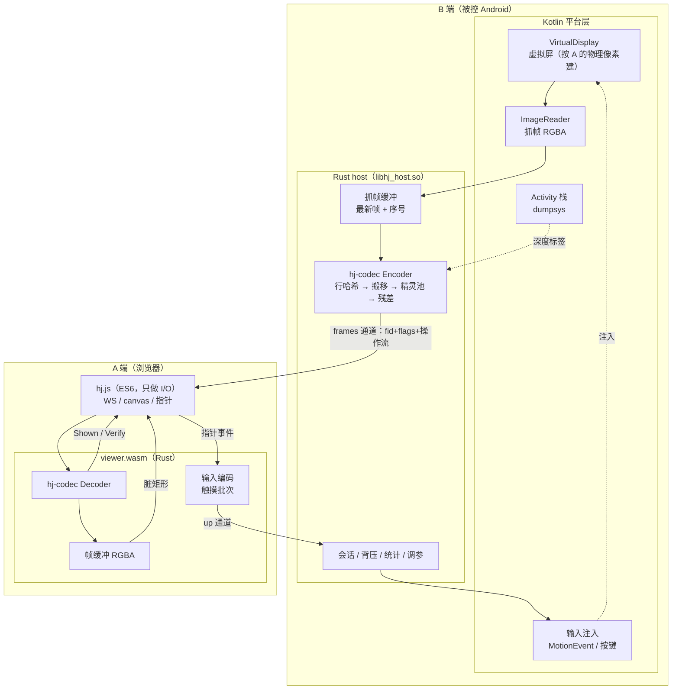
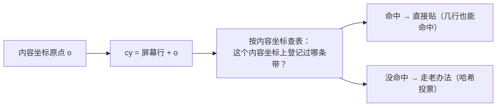

# 活镜 · 协议与数据面综述（人类可读版）

> 这份是给"第一次读这个项目的人"看的：讲清**框架**与**重点**，不抠实现细节。
> 数字与表格见上级目录的 [10-codec-modules.md](../10-codec-modules.md)。

## 0. 一句话

把 B（Android 手机）的一块**虚拟屏**，以**逐像素无损**的方式传到 A（浏览器或另一台手机），
并把 A 上的点按 / 滑动 / 滚轮 / 返回**注入**回 B。

不是视频会议，不是投屏：目标是 A 上看到的每一个像素都和 B 上一样（**0px**）。

## 0.1 先记住这三件事

1. **下行不是"视频帧"，是"操作流"**：B 端每帧算出行哈希，把画面拆成
   「整行搬移 / 纯色填充 / 字面量块 / 贴回池里的旧条带 / 整帧引用」几种操作，
   A 端按序重放 ⇒ 像素必然一致（0px）。字节花在**字面量**上（99.9%）。
2. **滚动不是"重发像素"，是"原点变"**：内容坐标里的 tile 不动，帧里只带一个**内容原点**；
   于是长截图 = 把内容空间的 tile 拼起来（这就是 tile 地图）。
3. **精灵池（retained）是省字节的大头**（关掉 +12%，真实节奏下 +65%）：
   见过再回来的内容不重发，典型是"返回上一页"的整页缓存。

## 1. 为什么要"逐像素"而不是视频

手机 UI 大量是**文字与纯色块**：H.264 这类编码器对静止 UI 很省，但一旦要"完全还原"，
文字边缘的振铃就会让像素对不上（实测同一批帧过 x264 CRF23：Settings 9.9%、LibChecker 95% 的像素与原图不同）。

所以这里走的是另一条路：**把画面当成"会动的拼图"来传**，只传"哪几块搬到了哪"，
这样接收端能一像素不差地复原。这条路的关键不是压缩率，而是**可复原性**。

## 2. 整体框架



**两条主线**

| 方向 | 通道 | 内容 | 频率 |
|---|---|---|---|
| B → A（下行，画面） | `frames` | 一帧的操作流（搬移/纯色/字面量/引用/贴池） | 每帧 |
| A → B（上行，操作） | `up` | 触摸采样批次、手势、按键、帧确认、帧缓冲哈希 | 每 JS tick |

外加一条低频 `ctl`（握手、开关会话、调试命令、事件）。

## 3. 数据面：把画面当拼图

### 3.1 六个动作

| 动作 | 含义 | 典型场景 |
|---|---|---|
| **整帧引用** | 这一帧和之前某一帧完全一样 | 返回上一页、关掉弹窗 |
| **整行搬移** | 若干整行从上一帧的某处搬到某处 | 滚动（列表上移 N 像素） |
| **纯色块** | 一块纯色 | 滚动条滑块、进度条、遮罩 |
| **字面量** | 一块矩形的原始像素（压缩后传） | 页面里新出现的内容 |
| **登记条带** | 把屏幕上的一整行条带存进"精灵池" | 滚走的内容 |
| **贴回条带** | 从池里把条带贴到新位置 | 滚回来的内容、返回上一页 |

### 3.2 像 tile 地图一样理解

这是理解整套设计最省力的方式：**屏幕是一张 tile 地图，行是 tile。**

```mermaid
flowchart LR
  subgraph 上一帧
    A1["tile 行 0..40"]
    A2["tile 行 40..80"]
    A3["tile 行 80..120"]
  end
  subgraph 池（精灵池）
    P["条带 id = 内容哈希<br/>（同一个内容只存一份）"]
  end
  subgraph 本帧
    B2["tile 行 0..40"]
    B3["tile 行 40..80"]
    B4["新露出的行"]
  end
  A2 -- "整行搬移" --> B2
  A3 -- "整行搬移" --> B3
  A1 -- "登记进池" --> P
  P -- "贴回" --> B4
```

- **摄像机移动 = 整行搬移**：列表滚 40px，本质是"地图往下挪 40 格"，不用重画。
- **tile 缓存 = 精灵池**：滚出屏幕的内容登记起来（条带 id = 内容哈希，相同内容自动去重），滚回来直接贴。
- **回到旧地图 = 整帧引用**：画面和之前一模一样就只说"回到第 N 张地图"。
- **新地块 = 字面量**：只有真正新出现的内容才需要传像素。

关键性质：**每一步都可验证**。编码器只发"已验证等于目标画面"的动作，
所以无论组合多复杂，接收端复原出来的画面一定是对的（0px）。

### 3.3 滚动的缓存（内容坐标 + tile 地图）

普通做法是"滚走的行按内容哈希投票找回来"——内容多的时候容易找错。
滚动画布的做法是：**给内容建坐标系**。



- 每次滚动，原点 `o` 按主位移更新；内容坐标 `cy = 屏幕行 + o`。
- B 维护"内容坐标 → 条带"的跨度表；露出的行先查表（哈希相等才用，坐标错了只是不命中）。
- 原点丢了（过度滚动拉伸、跳变）→ 下一个滚动帧按内容重新找，找不到就当换页、画布重来。
- **A 端完全不知道画布的存在**：它只看到普通的"登记/贴回"动作，所以协议不变。

### 3.4 返回与历史栈（整页缓存 = 最值钱的一块）

> 实测（786 帧语料）：**关掉精灵池，下行字节从 44.6MB 涨到 73.6MB（+65%）**——
> 比滚动检测（+4.7%）重要一个数量级。前提是"页面稳定 ≥120ms 才登记整页"这条能触发
> （用贴近真人的时间间隔测才能看到；模拟时钟会把它藏起来）。

| 场景 | 机制 |
|---|---|
| 同 App 内换页再返回 | 整页登记进池 → 返回时整屏贴回 |
| 退出 App 回桌面 | 首次要整屏像素（桌面是照片墙，最贵的一类）；之后靠池/整帧引用 |
| 依赖 Activity 栈 | B 在输入之后异步读 `dumpsys` 拿深度与栈顶，给池里的页面打**深度标签**；池满时先淘汰"更深"的（已经返回掉的页） |

深度标签的坑：B 查到新深度常常比换页第一帧还早到，所以标签要用**最近一次输入开始时的深度**，
否则刚被换掉的页会被标成"更深"，淘汰顺序就错了。

## 4. 协议框架（人类版）

| 层 | 东西 | 特点 |
|---|---|---|
| 线格式 | 长度前缀 + postcard（二进制） | 快、小；但**不自描述** → 枚举只追加、字段不改序、不兼容就升版本（现在 v3） |
| 通道 | `ctl` / `up` / `frames` / `video` | 按"频率与方向"分开，互不阻塞 |
| 消息 | 枚举即 schema | 同一批类型再导出 JSON，给调试工具与桥接用 |
| 帧 | `fid u32 + flags u8 + epoch u32 + origin i64 + 操作流` | 层间原子提交，不撕裂；`origin` = 内容坐标，`epoch` = 内容空间代号（换页时递增，A 据此清地图） |

热路径的字节数很小：一次触摸移动 **20 字节**，4 次合批 65 字节，一帧确认 9 字节。
QUIC/UDP/IP 头约 40 字节，所以**合批比单发划算**。

**v3 砍掉了什么**（复杂度治理）：A11y 树、剪贴板、blob 通道、**整个合成层调试**
（层开关 / 层归属线框 / APNG 导出）——现在只剩一份**只读**层列表。
长截图改成从 A 端的 tile 地图导出。

## 5. 真机数据（razr 40，mm1 构建）

| 场景 | 输入→首个新帧 p50 / p90 | 每帧字节 p50 / p90 |
|---|---|---|
| 连续滚轮 | 14.1 / 36.5 ms | 4.5 / 7.8 KB |
| 甩动（惯性） | 26.3 / 46.8 ms | 4.8 / 8.7 KB |
| 离散滚动手势 | 70.6 / 84.6 ms | 4.1 / 9.7 KB |

⇒ **p90 ≤120ms 达标**；稳态每帧 **≤10KB**。
分段里 **ImageReader 回调（App 响应 + 合成）占 5.7–62ms，是主导项**；我们的管线只占约 3ms。

## 6. 六个容易被误解的点

1. **"有损精灵 + 升级"还没做**：现在池里存的是"原样的行"，只有"见过再回来"才省；
   真正的"先有损发、静止后升级到无损"是设计里但没实现的（那才是照片类内容的大头）。
   顺带一个实测结论：**无损 WebP 虽然小一半，但 B 端编码一屏照片要 0.5–1.1 秒**，实时用不了；
   所以省照片字节只能靠"有损快档 → 升级"，不靠换无损编码器。
2. **视频层没有**：协议留了 `video` 通道，但没有任何实现。
3. **A11y 不在数据面上**：协议里曾经有 A11y 树，v2 删了；运行时从来没用过它。
   像素判定已经能保证 0px，A11y 只会滞后，只能当提示。
4. **tile 地图的 tile 现在是"整行"**：能表达纵向滚动与返回缓存，表达不了横向偏移（二期做 2×2 行块）。
5. **"稳态 ≤30KB/帧"对整屏照片不成立**：照片是照片级内容（壁纸、插画），无损就是 2.3MB；
   能做的是"先有损、静止后升级"（省首帧时间，不省总字节）。
6. **字形/字体层没有做，而且是有理由的**：早期设计有 `GLYPH_ATLAS`/`GLYPH_RUN`（把字形当精灵发，
   像 JPEG XL 的 patches 那样在字形级别去重）。放弃的原因是**字形同步在真机上做不到像素一致**
   （FreeType 探针的最优误差是 11.4/255，Android 各家字重字距还不一样）——
   而整个项目的硬要求是 0px，一个"近似对"的字形层等于破坏 0px 语义。
   顺带一提，文字的字面量已经只占下行 27%（17.7MB / 65.7MB），省字形也省不出多少字节；
   而且"把文字当成底色 + α 遮罩"这条路实测也只对约 **40%** 的文字节点成立
   （razr 语料，calculator 55% 直接失败、activitylauncher 一个都不精确）——
   差 ±1 也是差，一样破坏 0px。
   真要省，得先解决**字体同步**（连字体文件一起传，或只对能精确复现的字体启用）。

## 7. 相关开源项目

| 项目 | 值得借鉴的点 |
|---|---|
| **Xpra** | 最值得读：按窗口/区域自动选编码（无损 / webp / jpeg / 视频），有滚动检测，应用可给 content-type 提示，文字与图片分解，文字无损、图片有损后补到无损 |
| **VNC Tight / CopyRect** | 矩形分类（纯色/调色板/JPEG）；CopyRect 是滚动最便宜的表达 |
| **MRC (ITU-T T.44) / DjVu** | 前景/背景/掩码三层混成 —— "布局与图片独立质量"的理论原型 |
| **JPEG XL 的 patches** | 在图像格式内部做重复字形/图标去重（我们的"字形精灵"是同一思路） |
| **scrcpy** | 交互与传输的工程参照：虚拟显示、输入注入、背压、按通道分流 |

## 8. 相关的单页可视化

- [architecture.html](architecture.html) —— 架构与数据流（浏览器直接打开）。
- [bytes-and-latency.html](bytes-and-latency.html) —— 字节去哪了、每个机制值多少、字节与延迟的关系。
- [tile-map.html](tile-map.html) —— tile 地图（内容空间、视口、三个必须记住的坑）。
